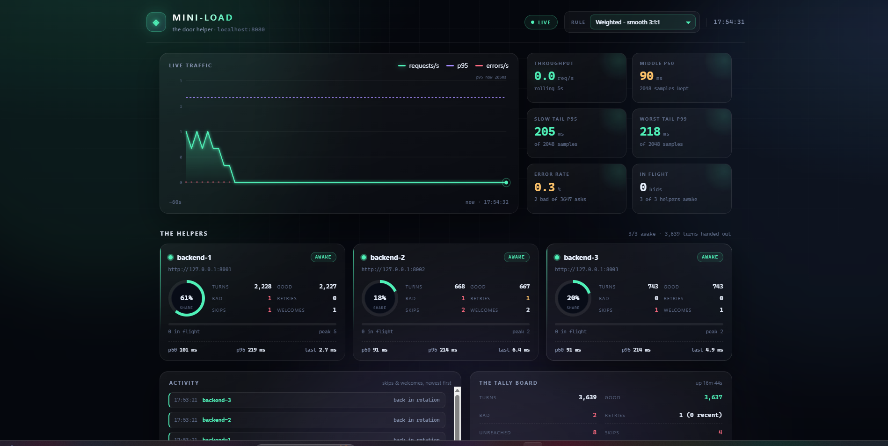
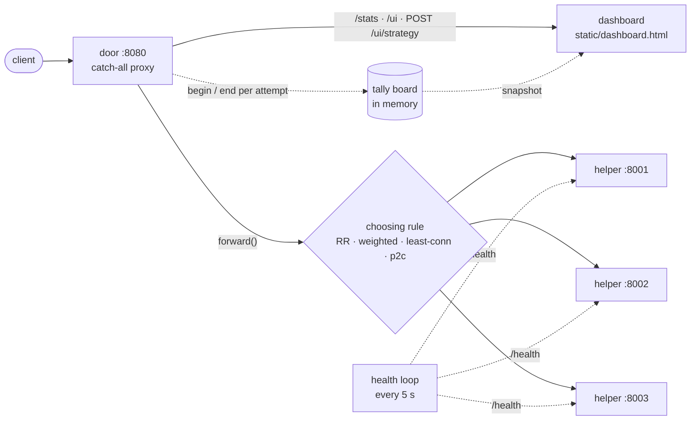

<div align="center">

# mini-load

**A load balancer written from scratch — four choosing rules, live health checks, and a dashboard that tells the truth.**

[](https://www.python.org/)
[](https://fastapi.tiangolo.com/)
[](https://www.python-httpx.org/)
[](#tests)
[](#the-dashboard)

No nginx. No Envoy. No JS framework. Every hop of the proxy path is ordinary Python you can read in one sitting.

<sub>Client → proxy → helper, with the tally board watching</sub>

</div>



---

## Why this exists

I wanted to know what a load balancer actually *does* between accepting a socket and writing a response: how it picks a target, what it does when that target dies mid-flight, and how you prove any of it without trusting a graph you didn't build. So this is a working layer-7 door with three helpers behind it, plus the instrumentation to answer those questions with numbers.

## How it works



Every attempt is timed and counted on both sides of the failure line, so a broken helper cannot disappear into a clean-looking error rate.

## Features

| | |
|---|---|
| **Four rules, one plug** | Round robin, smooth weighted 3:1:1, least connections, power of two choices. Swapped at runtime with one assignment — no restart, no dropped requests. |
| **Health checks with hysteresis** | Three consecutive misses eject a helper; two consecutive successes bring it back. Fails fast, flaps slowly. |
| **Awake-only routing** | Every rule filters to live helpers. If none are awake the door answers a clean `503` instead of a hung client. |
| **Idempotency-aware retries** | `GET`, `HEAD`, `PUT`, `DELETE`, `OPTIONS`, `TRACE` get one second chance. `POST` never does — you don't submit a payment twice. |
| **Streaming responses** | `aiter_raw()` keeps compressed bodies byte-identical; hop-by-hop headers stripped; `Set-Cookie` duplicates preserved. |
| **Real metrics** | Per-helper turns, errors, retries, skips, in-flight peaks, p50/p95/p99 from a bounded 2,048-sample window, rolling 5-second throughput. |
| **A dashboard with no build step** | One HTML file: SVG traffic chart, KPI cards, per-helper share rings, activity feed, live rule switcher, reduced-motion support. |

## Measured, not vibes

Every number below came from the running stack, and each is reproducible with the commands further down.

| Experiment | Result |
|---|---|
| Weighted 3:1:1 over 3,401 asks | `2,086 / 620 / 695` turns — a 60 / 18 / 20 split against a 60 / 20 / 20 target |
| Constant 15 req/s, 90 ms naps | 15.0 req/s achieved, p50 **101 ms**, p95 **108 ms**, **0** errors |
| Helper health knocked out during 1,200 asks | 1 skip, 1 welcome, **0 client failures** |
| 30-second total blackout (all helpers `/crash`) | ejected after **20 s**, `503` for **16 s**, fully back in **38 s** |
| Metric window | p99 computed over the most recent **2,048** samples, not all history |

A 30-second fault costing 38 seconds of service is the honest cost of a three-strikes health checker. Better designs shorten it; they don't make it zero.

## Quickstart

Four terminals, about a minute. Python 3.10+.

```bash
python -m venv venv
source venv/Scripts/activate      # Windows Git Bash; PowerShell: .\venv\Scripts\Activate.ps1
pip install -r requirements.txt
cp .env.example .env
```

**Terminals 1–3 — the helpers** (each needs its own port):

```bash
SERVER_NAME=sunny SERVER_PORT=8001 SERVER_WORK_DELAY_MS=0 python run.py
SERVER_NAME=buddy SERVER_PORT=8002 SERVER_WORK_DELAY_MS=0 python run.py
SERVER_NAME=rosie SERVER_PORT=8003 SERVER_WORK_DELAY_MS=0 python run.py
```

**Terminal 4 — the door:**

```bash
python src/main.py
```

Then open **http://localhost:8080/ui** and send it something:

```bash
python scripts/check_lb.py --requests 9    # 9 asks, one line each, rotating helpers
python scripts/load_test.py --rps 20 --ms 90 --duration 10
```

## API

| Route | What it does |
|---|---|
| `GET /stats` | Whole tally board as one JSON snapshot: rule, totals, per-helper stats, recent activity. |
| `GET /ui` | The dashboard. Registered before the catch-all, so it is never proxied upstream. |
| `POST /ui/strategy` | `{"strategy": "p2c"}` — swap the rule live. |
| *anything else* | Proxied to the chosen helper, path, query string, headers and body intact. |

`/stats` in one line:

```bash
curl -s localhost:8080/stats | python -m json.tool
```

## The rules

| Rule | Idea | Good at |
|---|---|---|
| `round_robin` | Take turns in order | Uniform helpers, simplest to reason about |
| `weighted_round_robin` | Smooth nginx-style 3:1:1 | Mixed capacity; no clumping of three in a row |
| `least_connections` | Shortest queue wins | Uneven request costs, head-of-line avoidance |
| `p2c` | Two random picks, take the lighter | Decentralised, cheap, hard to fool |

Select one without restarting:

```bash
curl -X POST localhost:8080/ui/strategy \
  -H "Content-Type: application/json" \
  -d '{"strategy": "least_connections"}'
```

## The dashboard

`static/dashboard.html` is a single file — inline CSS, inline JS, hand-rolled SVG, no CDN, no bundler, no framework. It polls `/stats` once a second and renders:

- an area chart of requests/s with a dashed p95 line and red error bars;
- throughput, p50/p95/p99, error rate and in-flight cards;
- one card per helper: status dot, traffic-share ring, in-flight meter, skips, retries, down-for timer;
- a timestamped activity feed of ejections and welcomes;
- a footer that checks `Σ helper turns = total turns` every second.

## Layout

```
mini-load/
├─ src/
│  ├─ main.py          entrypoint: pool, config, uvicorn
│  ├─ app.py           catch-all route, streaming, header hygiene
│  ├─ proxy.py         forward(): pick, retry, count, return
│  ├─ strategies.py    four rules + runtime StrategyManager
│  ├─ health.py        5 s knock loop in the FastAPI lifespan
│  ├─ metrics.py       counters, bounded latency window, percentiles
│  ├─ dashboard.py     /stats, /ui, /ui/strategy
│  ├─ pool.py          Backend and Pool
│  └─ config.py        env parsing
├─ backends/server.py  one FastAPI app: /, /health, /work, /crash
├─ scripts/            check_lb.py, load_test.py
├─ static/             the dashboard (one file)
├─ tests/              pytest: pool, strategies, health
└─ docs/               architecture notes, chaos log, algorithm notes
```

## Tests

```bash
python -m pytest tests -q
# 11 passed
```

## Design notes

- **Control routes first.** `/stats` and `/ui` are registered before the catch-all; otherwise the door would proxy its own dashboard to a helper.
- **One lock per rule.** Round robin's index is guarded by an `asyncio.Lock`; without it, concurrent picks can skip helpers.
- **Failures are recorded, not swallowed.** `metrics.end()` runs in every branch of every attempt, so `bad +` and `retries +` always reconcile.
- **No unbounded memory.** Latency uses a fixed-size window; events use a `deque(maxlen=...)`.
- **Swap is one assignment.** `StrategyManager.active` is read once per request; the rule a request started with is the rule it finishes with.

## Known rough edges

Honest list, kept current:

- the door's own `502`/`504`/`503` bodies are lost to a streaming bug (`StreamConsumed`) — status codes arrive, text does not;
- a retry can be re-sent to the helper that just failed (no exclusion yet);
- metrics are in-memory, so a restart zeroes the board and multi-process serving is not supported;
- `SERVER_WORK_DELAY_MS` is reported by `/` but `/work` sleeps only its query parameter.

## Roadmap

- [ ] Docker Compose — helpers reached by service name, one command to start everything
- [ ] Formal algorithm comparison at fixed load, with numbers in `docs/algorithm_notes.md`
- [ ] CI running pytest + a smoke test against the real stack
- [ ] Fix the error-body bug and the retry exclusion, with regression tests

---

<div align="center">
<sub>Built as a learning project: the proxy path, tests and thoughts are in the commits.</sub>
</div>
